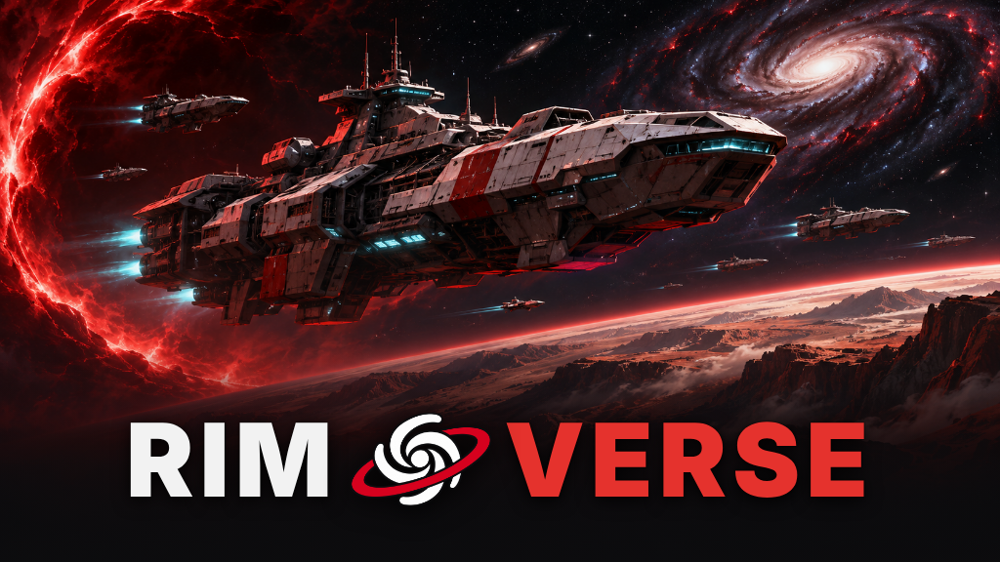

# Rimverse



**[Download Rimverse](https://github.com/AgricheX/Rim-Verse/releases/latest/download/Rimverse.zip)**

Rimverse takes your colony into an entire universe: your own ships, star systems, galaxies, living civilizations, real fleets, space combat, human lineages and fully self-sufficient survival in space.

It uses its own ship system (it does not depend on the Odyssey gravship) and runs on the base game, with optional integration for every DLC and several popular mods.

> **Status:** early version (0.0.1). The content is complete in code but has not been fully tested in game yet. Bug reports with the game log are very welcome.

## Features

### Ships
- Build ships from a bridge, hull floors and walls, and modules: engines, fuel and air tanks, air generators, radiators, batteries, solar panels, cargo bays, sensors, gravity generators and more.
- Four simple meters keep a ship alive: **integrity, air, power and heat**.
- Launch to orbit and land again; the whole ship (buildings, terrain and pawns) moves with you.
- A ship tab on the bridge with mass, thrust, fuel, crew, pilot and dodge, plus alerts for low air, high heat and low integrity.
- A compact ship HUD in the top right corner, designed to sit next to RimHUD and similar mods.
- Every ship building lives in a single **Rim Verse** architect tab; benches, furniture and decoration stay in the vanilla tabs.

### Space and travel
- Every game gets a generated home star system with planets, moons, belts and rings, with real orbits, gravity, temperature and atmosphere.
- **Sublight travel** between bodies of a system, **warp jumps** between stars, ancient **gates** and **wormholes** that can lead to other galaxies.
- A whole galaxy and its local group (up to 32 galaxies) generated from the seed, explored through a galaxy map.
- Sensors reveal more about what you scan (unknown, rough size, range, exact values) and fill a star catalog.
- Land on airless bodies, breathable worlds that use the base game biomes, and hostile worlds with thin, toxic or dense air.
- Vacuum suits and helmets with their own air supply.

### Civilizations
- Dozens of living civilizations per galaxy, including the ones from the RimWorld lore (sector Empire, glitterworld federations, urbworld corporations, pirates, mechanoids).
- 94 policies across government, ideology, economy, xeno and logistics, with elections, reforms, coups, civil wars and secession.
- Real fleets travel the galaxy, fight off screen and can arrive at your system as actual raids.
- First contact, diplomacy, orbital traders and physical currencies.
- **Information fog**: depending on your starting origin you know every civilization, only some of them, or none. The rest must be discovered through rumors, contact and intel.

### Combat
- Ship to ship combat with range bands, orders (approach, hold, flee, board), shields, missiles and point defense.
- Ship weapons such as autocannons, lasers, plasma, railguns and missile launchers.
- Boarding actions in both directions, surrender and captured ships.

### Life aboard
- Gravity per pawn: zero-g sickness, bone loss, heavy gravity strain, warp sickness and cabin fever.
- Eight human lineages adapted to different worlds (no Humanoid Alien Races needed).
- Generated alien fauna on breathable worlds and ship food.

### Colonies and endgame
- Found abstract colonies on other worlds, build industries and collect income.
- Colonies grow through tiers, get their own facilities, tithe modes and governors, and face events that ask for your decision.
- Found outposts on the planet surface by caravan.

### Your empire
- An **Empire** tab with your own government, civics and edicts.
- Build fleets of hulls and squads at your shipyards and send them to attack, capture, raid or blockade other systems. Battles can be auto-resolved or fought on a real map.
- Claims, war goals (conquest, subjugation, plunder, humiliation), war score and peace terms.
- Ask allies for help, found a federation, keep vassals, and watch out for coalitions if you grow too strong.
- A **Galactic Council** that votes on resolutions you can propose and lobby for.
- Space anomalies found while scanning, with research chapters, dangers and rewards.

### The Great Flow
- Some people are born sensitive to the Flow, or awaken it with a Resonance Shard.
- Two paths, **Harmony** and **Rupture**, with abilities such as push, sense, heal, calm, choke and storm.
- The Beam Blade, a melee weapon built around a Resonance Shard.
- Endgame crises and several endings, with the game continuing afterwards.

### Scenarios
Shipwreck, Drifting ship, Mining station, Imperial refugees, Glitterworld colony, Star tribe, Cryosleep awakening and Rich explorer, plus extra scenarios when Odyssey or Endless Rooms are active.

### Quality of life
A set of optional quality of life features, each one switched off automatically when the original mod that provides it is active. Everything can be configured in the mod settings.

## Requirements

- RimWorld **1.6** or **1.7**
- [Harmony](https://steamcommunity.com/workshop/filedetails/?id=2009463077)
- [Vehicle Framework](https://steamcommunity.com/workshop/filedetails/?id=3014915404)

No DLC is required. The Force and RimGram integrations need The Force Standalone + Lightsaber and RimGram, loaded before Rimverse.

## Optional integrations

Extra content loads automatically when these are active:

| Mod / DLC | What it adds |
| --- | --- |
| Royalty | Naval ranks, imperial permits, psycasts and the Empire tied to the lore civilization |
| Ideology | Space memes, precepts, rituals, roles and styles |
| Biotech | Space genes, xenotypes, mechanoids and an onboard school |
| Anomaly | Space entities, anomalous sites and events aboard ships |
| Odyssey | Gravships can be converted, Odyssey orbit layers are joined to the star system, suit compatibility |
| Combat Extended | Weapons, ammunition, armor, creatures, turrets, ship weapons and vehicle turrets converted to CE; hull breach rules also apply to CE projectiles |
| Endless Rooms | Integrated events and the A-sync researcher scenario |
| Save Our Ship 2 | Rimverse suits protect in SOS2 space |
| Vanilla Gravship Expanded 1 & 2 | Their substructures count as hull and grav engines as maneuvering thrusters |
| The Force (Standalone + Lightsaber) | The Great Flow and the Force are linked: Harmony with the Light, Rupture with the Dark, Resonance Shards work as kyber crystals |
| RimGram | Posts about your voyages, first contacts, wars, colonies, anomalies and life aboard, with a voice for each civilization, no signal during warp and a Star Network news feed |

Rimverse also checks for many other popular mods. When another mod already does something Rimverse does (vacuum, orbital traders, map generation, flying vehicles and more), Rimverse steps aside and uses that mod instead.

## Installation

1. Subscribe to Harmony and Vehicle Framework.
2. Download **Rimverse.zip** with the link above.
3. Extract it into `RimWorld/Mods/` so the folder `Rimverse` contains `About/About.xml`.
4. Enable it in the mod list, below Harmony and Vehicle Framework.
5. Start a new game with one of the Rimverse scenarios, or a normal start.

## Languages

English and Brazilian Portuguese.

## Building from source

The C# source is in `Source/Rimverse`. It targets .NET Framework 4.8 and needs reference assemblies from RimWorld, Harmony and Vehicle Framework (not included in this repository):

```
dotnet build Source/Rimverse/Rimverse.csproj -c Release -p:RefsPath=<path to refs>
```

`RefsPath` must contain `rw/` (RimWorld managed DLLs), `h/0Harmony.dll` and `vf/Vehicles.dll` + `vf/SmashTools.dll`. The output goes to `1.6/Assemblies/`.

## Author

Made by me, **Agriche**.
